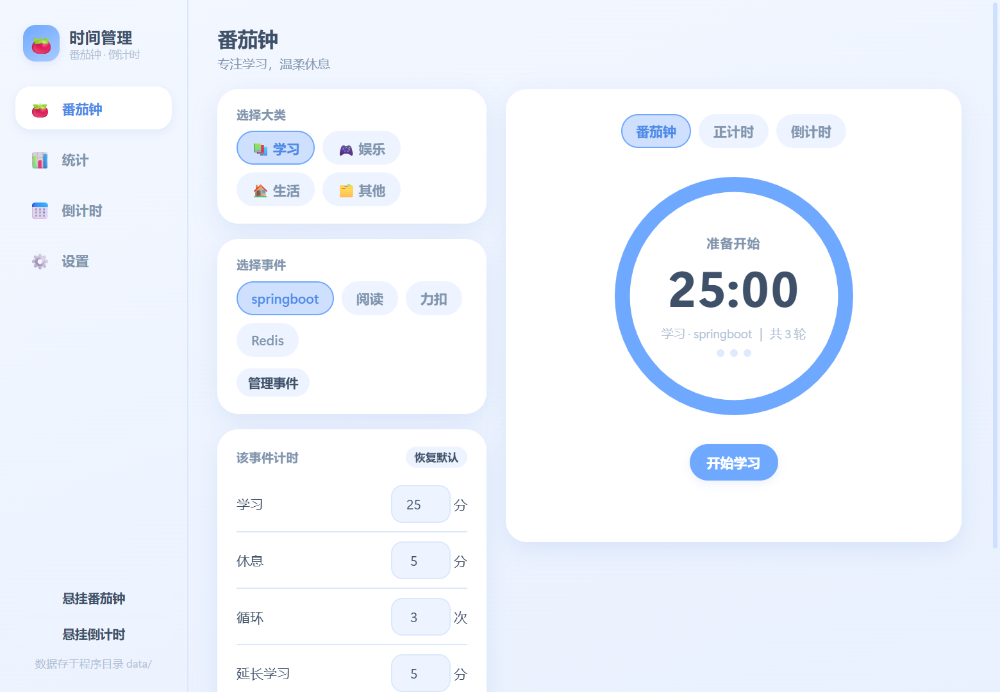

<div align="center">
  
  <h1>时间管理 · TimeManage</h1>
  <p><strong>番茄钟 + 倒计时日历</strong>，Windows 桌面与 Android 手机都能用</p>
  <p>
    
    
    
  </p>
</div>

一个轻量的跨平台时间管理应用：番茄钟专注计时 + 倒计时日历。蓝色柔和风格，数据全部保存在本机，支持 JSON 导入 / 导出与同一局域网内的双向同步。

技术栈为 **Tauri v2**（Rust 后端 + 系统 WebView）+ 原生 HTML / CSS / ES Module：无前端框架、无打包器，前后端代码都很小，便于阅读和二次开发。

## 作者的话

市面上的番茄钟大多不合我意：或是收费，或是功能太繁杂。刚好 AI 已经足够强，我索性用 vibe coding 的方式写了一个简单的番茄钟，解决掉自己的需求。

它没有账号、没有会员、没有推送，只做计时与记录。如果它刚好也符合你的使用习惯，欢迎自取；有想法或问题，提 Issue 就好。

## 截图

<p align="center">
  
</p>
<p align="center">
  
  
</p>

## 功能

**番茄钟**
- 三种模式：番茄钟（学习 / 休息循环）、正计时、倒计时。
- 四大类（学习 / 娱乐 / 生活 / 其他），每类下可自定义事件；每个事件单独记住自己的计时配置，切换事件自动套用。
- 暂停（暂停时间不计入统计）、提前结束、延长学习 / 休息；延长超过默认时长会提醒「应该休息了」，但仍可继续。
- 学习结束弹出置顶提醒窗并播放温和的合成提示音，音量可调。

**统计**
- 按大类分别显示时长 / 次数 / 延长，支持日 / 周 / 月 / 年 / 总计与「跳到日期」。
- 按分类堆叠的趋势图，大分类 / 小分类切换。
- 记录明细按日 / 月 / 年分组、分页，可编辑、删除、手动补录，支持批量操作。
- 计时器只把**学习阶段**写入记录，休息不自动记录。

**倒计时日历**
- 添加 / 编辑 / 删除倒计时事件，支持每年重复。
- 日历上显示剩余天数，侧栏按临近程度排序，到期与提前提醒。

**桌面悬浮窗**
- 番茄钟悬浮窗置顶，倒计时悬浮窗不置顶；都可在窗内完成全部操作、拖动缩放、折叠为透明小圆图标、拖到屏幕左右边缘自动收缩成细条。
- 系统托盘、单实例（重复启动只聚焦已有窗口）。

**Android 版**
- 底部四页导航、单列卡片、全面屏安全区适配。
- 前台服务常驻计时通知，通知内可暂停 / 继续 / 停止；进程被杀后由快照恢复计时。

## 快速开始

### 直接使用（Windows）

从 [Releases](https://github.com/xiyueying-677/TimeManage/releases) 下载 `TimeManage.exe`，放到任意目录双击运行即可。程序是便携的：数据保存在 exe 同目录的 `data/` 文件夹，整个文件夹拷走就带走了数据。

> Windows 10 / 11 自带 WebView2；较老的系统可能需要安装 [WebView2 Runtime](https://developer.microsoft.com/microsoft-edge/webview2/)。

### 从源码构建

前置：Node.js 22+、Rust（stable）、Visual Studio C++ 生成工具、WebView2 Runtime。

```bash
npm install          # 安装 @tauri-apps/cli
npm run dev          # 开发模式
npm test             # 前端纯函数单元测试（node --test）
```

桌面发布构建：

```bash
cd src-tauri
cargo build --release
# 产物：src-tauri/target/release/timemanage.exe
```

需要 MSI / NSIS 安装包时执行 `npm run tauri build`。

Rust 单元测试：`cd src-tauri && cargo test --lib`。

### Android

构建步骤、必须保留的修复和常见坑见 [docs/android-build.md](docs/android-build.md)。提醒：不要删除 `src-tauri/tauri.js` 与 `gradle.properties` 里的 `kotlin.incremental=false`，否则 Android 构建会失败。

## 数据与隐私

- **数据只存在本机**：没有账号、没有遥测、没有后台请求；除局域网同步外不联网。
- 桌面数据目录：程序同目录的 `data/`（开发时为 `src-tauri/target/debug/data/`）；目录不可写时回退 `%APPDATA%\TimeManage\data`；可用环境变量 `TIMEMANAGE_DATA_DIR` 指定。
- Android 数据：应用私有目录，普通用户通过设置页的系统文件选择器导入 / 导出。
- 导入与同步都按 `id` 合并、**只增不删**：重复记录自动去重，不会覆盖本机已有记录；`ui`（窗口位置等设备本地状态）不参与导入 / 同步。
- 数据文件是通用 JSON（`schemaVersion` 2），桌面与手机之间可互相导入导出，建议定期导出备份。

## 局域网同步与安全

- 在设置页的「局域网同步」卡片里，手机或电脑都可以当主机：主机显示本机 IP、端口（默认 18923）和 6 位配对码，另一端填入即可双向合并。
- 同步走**明文 HTTP**，只适用于同一可信 Wi-Fi / 手机热点；不要做公网端口映射。
- 电脑作主机时，需要在 Windows 防火墙放行专用网络与 18923 端口。
- 配对码只用于局域网内配对，请勿在公开渠道分享主机地址与配对码。

## 项目结构

```text
src/                     前端：页面、样式与业务逻辑（ES Module，无打包器）
  js/store.js            数据加载 / 订阅 / 所有写操作
  js/timerClient.js      计时命令与事件订阅
  js/stats.js calendar.js 纯函数（有单元测试）
  js/floatShell.js       悬浮窗公共外壳（拖动 / 缩放 / 折叠 / 贴边）
src-tauri/src/           Rust 后端：计时引擎、存储、倒计时、托盘、局域网同步
src-tauri/plugins/timer-notification/   Android 前台服务通知插件（Kotlin + Rust）
src-tauri/gen/android/   已提交的 Android 工程
docs/                    架构与 Android 构建文档
```

更完整的架构、数据模型、命令与代码约定见 [docs/architecture.md](docs/architecture.md)。

## 文档

- [架构说明](docs/architecture.md)：技术栈、目录、数据模型、接口、关键代码约定、计时引擎。
- [Android 构建](docs/android-build.md)：环境、命令、必须保留的修复、冷启动问题与常见坑。

## 贡献

欢迎 Issue 和 Pull Request。提交前请确认 `npm test` 与 `cargo test --lib` 均通过；Android 相关改动请附上构建结果。详细约定见 [CONTRIBUTING.md](CONTRIBUTING.md)。

## 许可

[MIT](LICENSE) © 2026 xiyueying
